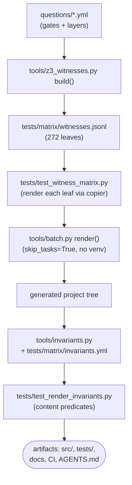
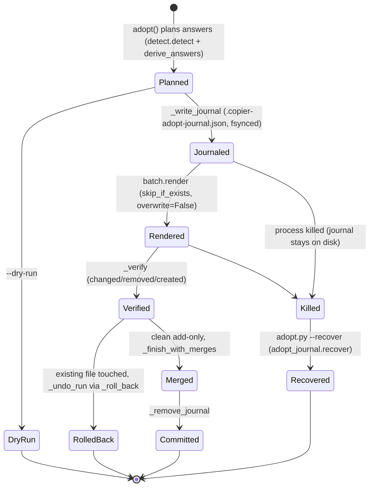
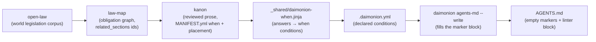
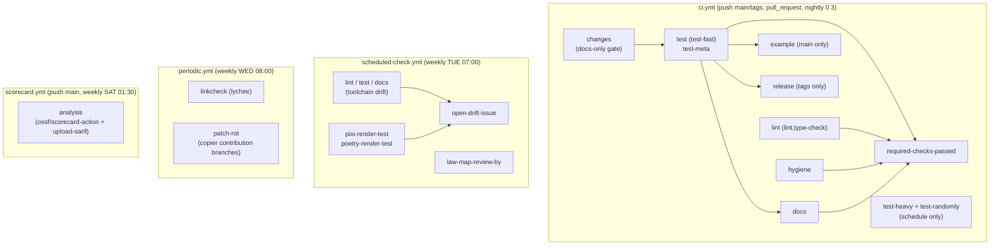

# Processing Flows

Four end-to-end flows in one place: how answers become a project, how adoption
stays reversible, how legal content reaches `AGENTS.md`, and which CI workflow
watches what. Each diagram names real files, jobs, and tools — the prose under
it points at the implementation.

## Questionnaire to generated project

`questions/` declares the gates, `tools/z3_witnesses.py` enumerates the leaf
space, `tools/batch.py` renders each leaf through copier, and the invariant
layer checks the output. Details live in [Verification Architecture](verification.md).

The render is a pure function of the template's git tree: the same commit
produces the same output. Anything that would break that (network fetches,
per-render stamps) is excluded or masked — see `mask_render_stamps` in
`tools/batch.py`.

## Adopt and update: the crash-safe transaction

Two layers cover two failure classes: the in-process rollback
(`_signals_roll_back` in `tools/adopt_crash.py`, plus `_roll_back` in
`tools/adopt_tree.py`) handles failures the process survives; the journal
(`JOURNAL_NAME` in `tools/adopt_types.py`) covers kills — while it exists,
the run has not committed, so `--recover` can finish the undo. A stale
journal blocks the next run (exit 4) until it is recovered.

## Ethics and law distribution pipeline

Legal content flows downstream through three external repositories before it
reaches a generated `AGENTS.md`. The full contract is
[Ethics as External Source](ethics-external.md); this is the same chain as a
pipeline.

Watchers on the chain, each naming exactly one failure:
`scheduled-check.yml` job `law-map-review-by` (expired `review_by`
groundings, `law-map check --codex`), and the `e2e` job in
`e2e-ecosystem.yml` (`law-map export` + kanon validate + a render whose
`.daimonion.yml` declares the expected conditions). The generated
project's own `legal-check` task (`_tasks.jinja`, `daimonion diff --strict`)
is the downstream consumer, not a watcher. There is no vendor-sync watcher
anymore: nothing is vendored, so prose drift cannot happen here.

## CI at a glance: four lanes

Each scheduled lane is staggered so a red run names exactly one cause.
`ci.yml` handles push/PR plus the nightly heavy tier; the weekly lanes only
watch drift that push/PR CI cannot see.

Adjacent but separate: `pr.yml` (job `validate-pr-title`, conventional-commit
titles), `e2e-ecosystem.yml` (weekly FRI cross-repo chain),
`dependency-audit.yml` (weekly pip-audit), `security.yml` (zizmor workflow
audit), and `update-rehearsal.yml` (the `copier update` path the adopt flow
depends on).
